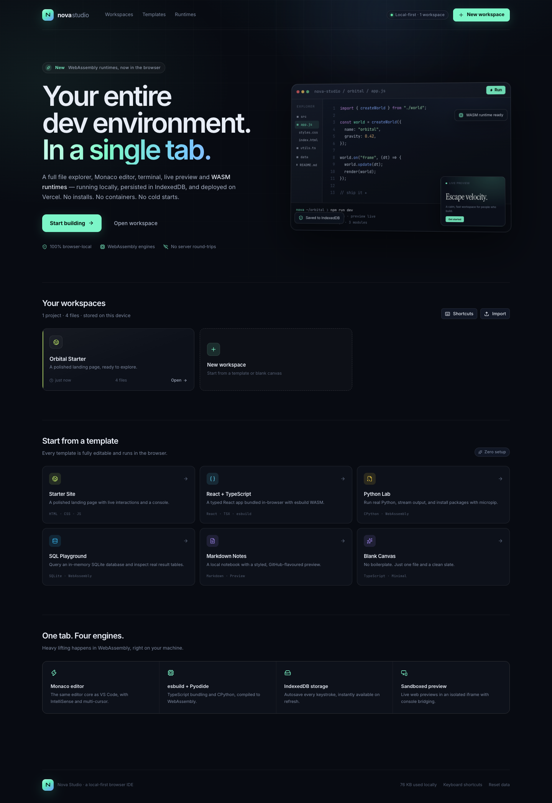
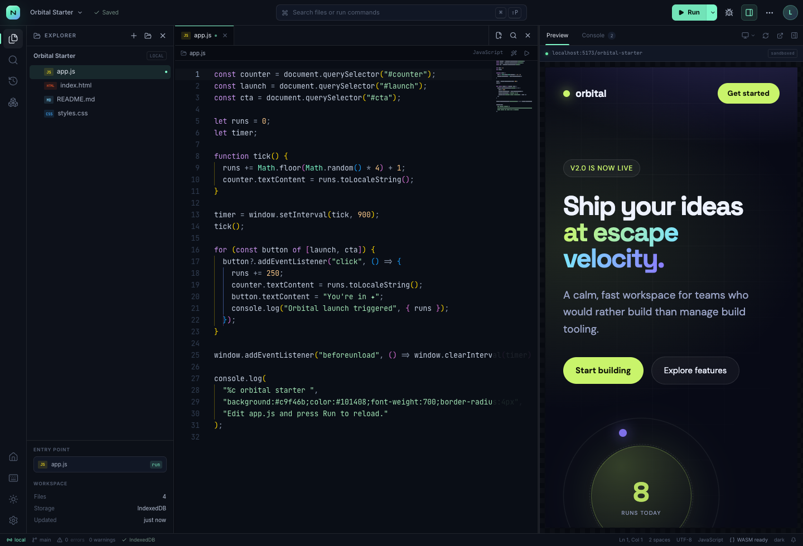
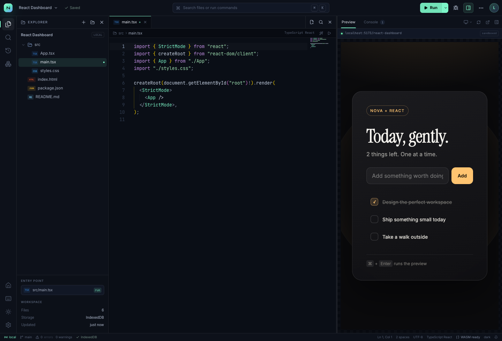
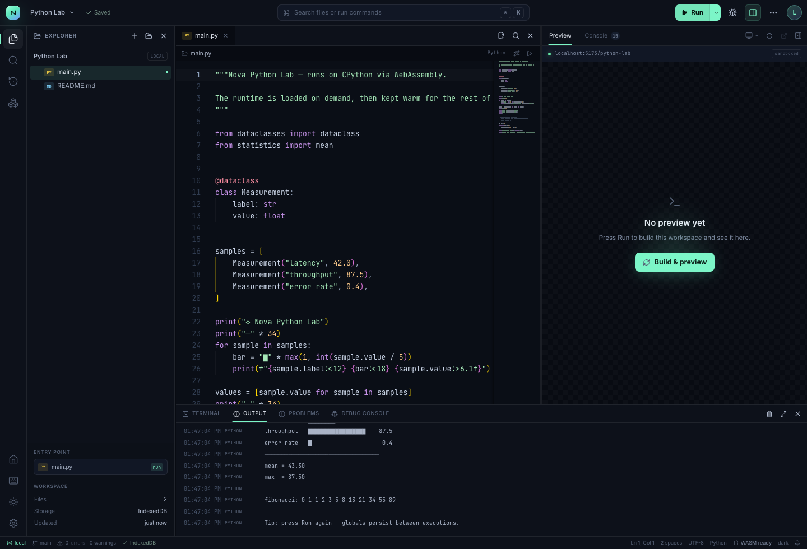
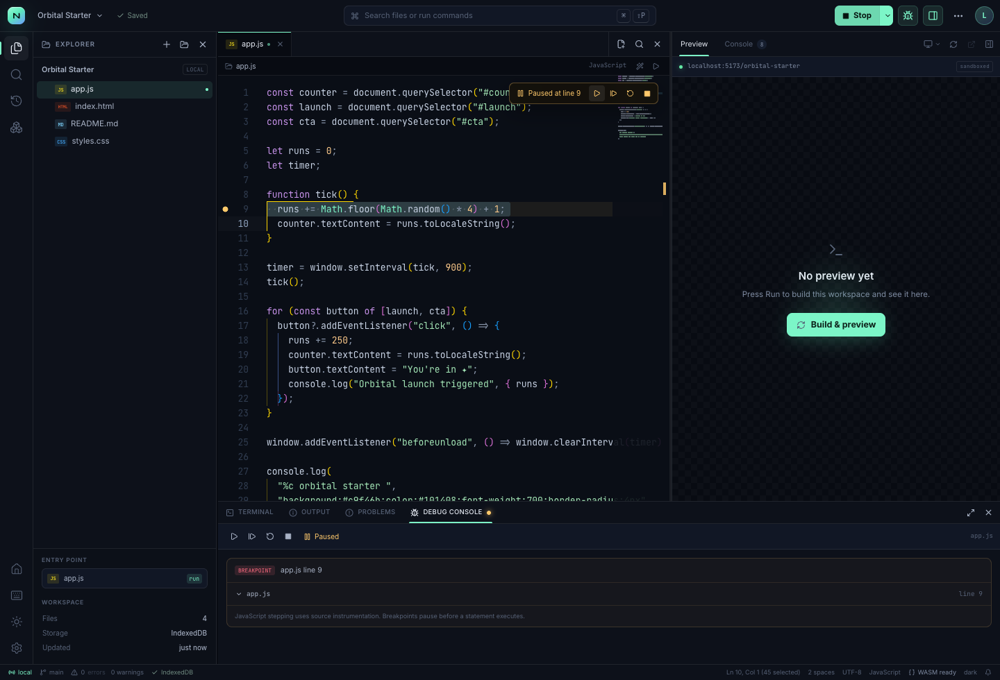

# Nova Studio

**A complete, local-first development environment that runs in a browser tab.**
Monaco, a file explorer, IndexedDB storage, WebAssembly runtimes, a terminal, live previews, checkpoints and a JavaScript stepper — deployable to Vercel's free tier with no backend.



## Why this exists

Nova is a browser-native IDE. Projects are real folders and files, but they live in **IndexedDB on the user's own device**. There is no container to boot, no remote filesystem, and no server bill. The heavy engines — esbuild, CPython and SQLite — are compiled to WebAssembly and execute inside the tab.



| | |
| --- | --- |
|  |  |
| React + TypeScript bundled by esbuild WASM | CPython via Pyodide with streamed output |

## What is included

### Workspace and files
- Multiple isolated projects, persisted per browser profile and per origin.
- File explorer with folders, nested files, create/rename/delete/duplicate, context menus and entry-point selection.
- Tabs, breadcrumbs, syntax highlighting, auto-save, word wrap, minimap, ligatures and configurable font/tab size.
- Import/export entire workspaces as **ZIP** (plus `.nova.json` export helpers).
- Project checkpoints (local snapshots) with one-click restore and safety snapshot before restore.
- Dark and light themes, resizable editor/preview/panel layout, status bar and command palette.
- Full-workspace search with case, whole-word and regex modes.
- Quick open (`Ctrl/Cmd + P`), command palette (`Ctrl/Cmd + Shift + P`) and keyboard shortcuts modal.
- Local storage usage inspector and autosave toggle.

### Runtimes
| Language / format | Engine | Run | Debug |
| --- | --- | --- | --- |
| JavaScript, TypeScript, JSX, TSX | `esbuild-wasm` | Yes | Step debugger* |
| HTML, CSS, static sites | Native browser sandbox | Yes | Console only |
| Python 3 | Pyodide (`CPython` WASM) | Yes | Output/console |
| SQLite | `sql.js` WASM | Yes — result tables | Output/console |
| JSON | Native parser | Validate / pretty preview | — |
| Markdown | `marked` | Styled preview | — |

\* The JS/TS debugger instruments the active standalone file so it can pause on breakpoints and step statement-by-statement. Files that use `import`/`require` must be split into a standalone script first. Python stepping is intentionally not simulated; Python output is streamed to the Output panel.

Bare npm imports in web projects are externalised and resolved by the browser through [esm.sh](https://esm.sh). The default React template demonstrates this with React 19.

### Terminal
The terminal is a real interactive shell experience (xterm.js) over the workspace, not a remote POSIX host. It supports:

```text
ls, cd, pwd, cat, tree, touch, mkdir, rm, mv,
open, run, node, python, pip install, sqlite,
export, theme, projects, shortcuts, clear, help
```

`pip install` uses Pyodide's `micropip`. The shell also exposes runtime commands that trigger the same build/debug pipeline as the UI.

### Preview and debugging
- Sandboxed iframe previews with local CSS inlining, esbuild bundling, ESM import maps and console bridging.
- Live preview rebuilds after edits (toggleable in Settings).
- Desktop/tablet/mobile preview widths, refresh, and open-in-new-tab.
- Breakpoints by clicking the editor gutter; continue, step, restart and stop.
- Debug console includes current pause location and instrumentation notes.



## Run locally

Requirements: Node.js 20.9+ and npm.

```bash
npm install
npm run dev
```

Open <http://localhost:3000>.

> On macOS, `npm run dev` automatically uses webpack's polling watcher. This avoids a known FSEvents hang for projects under `~/Desktop` (or otherwise restricted folders). Production builds still use Turbopack.

On the first run Nova seeds one starter project. Everything else is stored locally. To start clean, use **Reset data** in the dashboard footer (or clear site data for the origin).

### Production build

```bash
npm run build
npm start
```

The build copies the self-hosted Monaco distribution and esbuild's WebAssembly binary into `public/` (via `postinstall` / `prebuild`). This keeps the editor and JS/TS bundler fast and avoids runtime CDN dependencies for the core toolchain. Those folders are generated and gitignored — do not commit them.

## Deploy to Vercel (Free / Hobby)

Nova is a standard Next.js App Router application with no serverless functions, database, or environment variables. Vercel's free tier is enough.

### Option A — CLI

```bash
npm i -g vercel
vercel
vercel --prod
```

### Option B — Git

1. Push this directory to a Git repository.
2. Import it at <https://vercel.com/new>.
3. Keep the detected framework preset **Next.js** and the default build command.
4. Deploy.

No environment variables are required. The first production request serves only static HTML/CSS/JS; WebAssembly runtimes are downloaded on demand and cached by the browser.

> **Data is origin-scoped.** A user who visits `nova-a.vercel.app` and then `nova-b.vercel.app` gets two independent local workspaces. Deploy on a stable domain if users should keep their projects. Export a ZIP before moving origins.

## Architecture

```text
app/                     Next.js App Router, global design system, IDE layout CSS
components/
  NovaApp.tsx            boot, project lifecycle, autosave, URL routing
  Home.tsx               dashboard, templates, import, project cards
  ide/
    IDE.tsx              orchestration: run, debug, palette, dialogs, runtime messages
    CodeEditor.tsx       Monaco configuration, themes, breakpoints, diagnostics
    EditorArea.tsx       tabs, breadcrumbs, welcome state
    Sidebar.tsx          explorer, search, checkpoints, runtimes, settings
    PreviewPane.tsx      sandboxed preview and console
    BottomPanel.tsx      terminal, output, problems, debug console
    Terminal.tsx         xterm.js shell over the workspace
    CommandPalette.tsx   commands and quick open
lib/
  db.ts                  Dexie/IndexedDB projects, settings, checkpoints
  store.ts               Zustand workspace state
  web-build.ts           in-browser esbuild WASM bundling + HTML/import-map injection
  debug.ts               Babel source instrumentation + debug runtime
  sql.ts                 sql.js loader and query execution
  templates.ts           starter projects
public/runtimes/         Python Web Worker
scripts/copy-assets.mjs  copies Monaco + esbuild WASM into public/ during install/build
```

### Persistence

- **Dexie / IndexedDB** for projects, checkpoints, and preferences.
- Active project is reflected in the URL (`?project=<id>`) so reloads reopen it.
- Autosave debounces writes; turning autosave off marks the workspace **Unsaved** and prompts before leaving the page.
- Manual save writes immediately.
- There is **no account or cloud sync** by default. Isolation is per browser profile and origin.

### Security model

User code is untrusted and therefore runs inside a sandboxed iframe without `allow-same-origin`. Preview code cannot read the IDE's IndexedDB or DOM. Python runs in a dedicated Web Worker. Debugging uses a separate, hidden sandboxed iframe. The SQLite database is in-memory in the tab.

This is still a client-side development tool: do not paste secrets or private keys into projects that you do not intend to keep on that device.

## Keyboard shortcuts

| Action | Shortcut |
| --- | --- |
| Quick open | `Ctrl/Cmd + P` |
| Command palette | `Ctrl/Cmd + Shift + P` |
| Go to line | `Ctrl/Cmd + G` |
| Toggle sidebar | `Ctrl/Cmd + B` |
| Toggle terminal | `Ctrl/Cmd + J` or `Ctrl/Cmd + \`` |
| Search workspace | `Ctrl/Cmd + Shift + F` |
| Run project | `Ctrl/Cmd + Enter` |
| Run current file | `Ctrl/Cmd + Shift + Enter` |
| Debug current file | `F5` or `Ctrl/Cmd + Shift + D` |
| Toggle preview | `Ctrl/Cmd + Shift + V` |
| Save | `Ctrl/Cmd + S` |
| Create checkpoint | `Ctrl/Cmd + Alt + S` |
| New file / folder | `Ctrl/Cmd + N` / `Ctrl/Cmd + Shift + N` |
| Keyboard shortcuts | `Ctrl/Cmd + K` |

## Honest limitations

This is a serious browser IDE, not a byte-for-byte clone of desktop VS Code.

- **No real Node.js server process or arbitrary native toolchains.** JavaScript/TypeScript is bundled with esbuild WASM; npm packages that require Node built-ins will not run. WebContainers could be added, but require cross-origin isolation and a commercial license for many uses.
- **Debugging is JS/TS-only for stepping.** Python has run/console output but not line stepping.
- **No Git remote, extensions marketplace, language servers, collaboration, or cloud sync.** Checkpoints are the local version-history substitute.
- **Pyodide and sql.js are loaded from CDNs on first use.** Monaco and esbuild are self-hosted; after the browser caches the other engines they keep working, but a strictly offline build should vendor those assets too.
- **Large language support is syntax-level.** Monaco ships rich editing for many languages, but Nova only executes the runtimes listed above.
- **Uploads are text-based** through the import flow (JSON/ZIP). Binary assets can be included via ZIP import.

## Extending

- Add a runtime: create a worker or WASM loader, map file extensions in `lib/languages.ts`, and add a branch to `runCurrentFile`/`runProject` in `components/ide/IDE.tsx`.
- Add a language service: configure a Monaco worker and `monaco.languages.*` provider in `CodeEditor.tsx`.
- Add cloud sync: replace the Dexie persistence layer in `lib/db.ts` with a user-scoped backend (Supabase, Neon, etc.) while keeping the local cache.
- Add Node/npm: integrate `@webcontainer/api` behind a feature flag, add COOP/COEP headers, and self-host every cross-origin asset.

## Credits

Built with [Next.js](https://nextjs.org/), [Monaco Editor](https://microsoft.github.io/monaco-editor/), [esbuild](https://esbuild.github.io/), [Pyodide](https://pyodide.org/), [sql.js](https://sql.js.org/), [xterm.js](https://xtermjs.org/), [Dexie](https://dexie.org/), [Zustand](https://zustand.docs.pmnd.rs/), [JSZip](https://stuk.github.io/jszip/) and [lucide](https://lucide.dev/).

Nova Studio is a demo-quality engineering project built for the browser. MIT licensed if you want to take it further.
